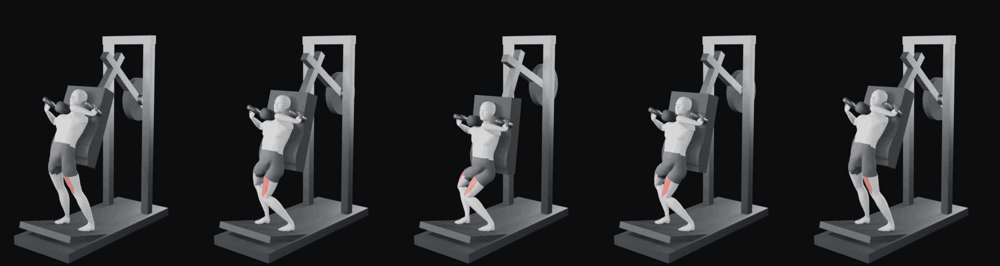

# Pendulum squat — rig de contacto MPFB

> **ENTREGA RECHAZADA POR EL DUEÑO (2026-10-21).** El GIF y el blend de la
> primera entrega deforman las extremidades. Los PASS históricos de abajo
> sólo acreditan las comprobaciones geométricas que se implementaron; no
> acreditan una figura ni un movimiento humano aceptables. La corrección está
> en revisión. No usar esta versión en la app.

Trabajo de Codex en `diseno/sistema-visual`, limitado a esta carpeta. El dueño
autorizó después del diagnóstico **recalibrar los apoyos del carro**, manteniendo
plataforma, proporciones y MPFB. No se reclama ni publica turno en main.

## Corrección v2 — candidata a revisión visual

Salidas nuevas en **revision-v2/**; la primera entrega no se sobrescribe.
El fallo era asignar `pole_angle=0` a las cuatro cadenas IK, sin compensar
la orientación local de sus huesos. Esto giraba el plano de rodillas y codos:
las posiciones objetivo se alcanzaban aun con las extremidades retorcidas.
Ahora se calibra cada plano de flexión hacia su polo mediante la geometría
evaluada. No se teclean posturas ni se modifican las proporciones de MPFB.

- [GIF corregido](revision-v2/pendulum-squat-rig.gif): 229 693 bytes, GIF89a,
  360×480, 17 fotogramas, 9 fps de exportación, 40 colores y fondo `#0b0c0d`.
- [Escena corregida](revision-v2/pendulum-squat-rig.blend): restricciones y
  drivers nativos, sin handlers. Sigue gobernada sólo por Pivote.
- [Prueba de orientación](revision-v2/orientacion.json): 23 fotogramas y
  cuatro posiciones sin clave. Torsión máxima de piernas 6.84°, antebrazos
  7.98° y diferencia de simetría <0.043 mm. Son guardas de regresión de este
  prototipo, no límites biomecánicos universales.
- [Geometría](revision-v2/aceptacion.json): contactos y demás criterios
  geométricos pasan. **`aceptado` permanece `false`**: la revisión visual y la
  aceptación del dueño no se sustituyen por estos números.

La revisión incluye el cuerpo sin máquina, de frente y de lado, en reposo,
arriba y abajo; además de la secuencia con máquina. Se conserva evidencia en
`revision-v2/anatomia-*.png`. No se retocan imágenes para ocultar deformaciones.
El rostro y el acabado del maniquí siguen fuera del alcance original.

La prueba nueva se ejecutó también contra el blend rechazado: falla por
torsión, asimetría, orientación de flexión y posición de codos. Blender se
ejecuta ahora con `--python-exit-code 1` para que una excepción Python detenga
realmente la regeneración. El script no declara aceptación visual automática.

## Primera entrega — rechazada, conservada como historial

- **pendulum-squat-rig.blend**: escena de salida. Rig MPFB original más 16 huesos
  auxiliares no deformantes. No usa Rigify ni necesita handlers de Python para
  moverse. Se abre con restricciones y drivers nativos de Blender.
- **pendulum-squat-rig.gif**: GIF final, 360×480, 17 fotogramas, 9 fps de
  exportación, 40 colores usados, 244 327 bytes. Primer fotograma arriba; fondo
  `#0b0c0d`. Conserva el formato de la app y queda por debajo de 250 000 bytes.
- **pendulum-squat.blend / pendulum-squat-v1.gif**: fuentes originales intactas.
- **aceptacion.json**, **validacion-rig.json**, **contactos-superficie.json** y
  **validacion-gif.json**: resultados numéricos regenerados por el comando.



La comparación con demostraciones reales, sus fuentes y las diferencias de
geometría están en [REFERENCIAS-MOVIMIENTO.md](REFERENCIAS-MOVIMIENTO.md).
Las pruebas de contacto de abajo no equivalen a una validación biomecánica.

## Regenerar desde cero con un comando

Desde la raíz de esta copia de diseño:

```bash
bash arte/sistema-visual/3d/regenerar.sh
```

Requiere Blender 5.2.2 LTS, `python3` con Pillow y `ffmpeg`, ya disponibles en
esta máquina. Para otra instalación, definir `PS_BLENDER` con la ruta del
ejecutable. No instala dependencias. Todas las salidas quedan aquí; las carpetas
`fotogramas/`, `composicion/` y los logs son intermedios ignorados por Git.
La salida por defecto es `revision-v2/`; `PS_RESULTADO_DIR` permite elegir otra
subcarpeta. El comando falla si la geometría, la regresión de orientación o el
GIF no pasan sus comprobaciones. Superarlas no equivale a aprobación visual.

## Cómo se mueve

**Sólo `Pivote.rotation_euler.x` gobierna el recorrido.** Tiene tres claves:
fotogramas 1, 12 y 23. Arco recalibrado: aproximadamente −40.967° → −24.905° →
−40.967°. No hay claves de pose del cuerpo ni una corrección animada de su
posición vertical. `Human.location` sigue en `(0,0,0)`.

- Pies: objetivos fijos en la plataforma y orientación fija. Dos cadenas IK de
  dos segmentos anatómicos, sin estiramiento, transmiten el resultado a los
  huesos divididos de MPFB. Los polos mantienen el plano de las rodillas.
- Manos: muñecas fijadas a objetivos hijos del carro; cada dedo tiene una
  cadena IK de tres segmentos que alcanza la superficie del cilindro. Los
  objetivos se calculan con la longitud real de cada dedo.
- Pelvis/columna: el rig sigue el carro y una cadena IK resuelve las cinco
  vértebras. El pequeño ajuste pélvico se deriva del mismo ángulo; las cinco
  vértebras cambian entre arriba y abajo. No se mueve el torso como una pieza
  rígida ni se teclean ángulos de rodilla/cadera.
- Apoyos autorizados: hombreras colocadas sobre la superficie de los hombros;
  frente del acolchado contorneado desde la malla evaluada. La espuma acompaña
  la acomodación con una shape key dirigida por el mismo ángulo, con cambio
  máximo de perfil de 8.09 mm. No es un desplazamiento del cuerpo para ocultar
  que los pies se despegan.

Las longitudes y coordenadas de reposo de los 137 huesos originales se conservan.
Plataforma y todas las piezas distintas de respaldo/hombreras conservan malla,
transformación local e inversa de emparentado. Luces, materiales, cámara, motor
y muestras no se modifican. El render del GIF usa alfa y composición de fondo;
esto conserva la iluminación y garantiza el RGB requerido. El v1 tenía esquina
RGB `(26,29,31)`, aunque el encargo indicaba `(11,12,13)`.

## Mediciones históricas de la primera entrega (no aceptación visual)

Se comprueban los 23 fotogramas y cuatro ángulos no clavados moviendo sólo el
pivote. El archivo se vuelve a abrir en procesos independientes de Blender para
medir las superficies y renderizar.

| Criterio | Resultado |
| --- | --- |
| Pivote único; IK sin estirar; sin claves de pose | PASS |
| Desplazamiento Z del tobillo entre 1 y 12 ≤1 cm | PASS: 0.066 mm |
| Error máximo de objetivo de pies | PASS: <0.068 mm |
| Muñecas y puntas de dedos en objetivos | PASS: <0.01 mm |
| Rodilla arriba, sin bloqueo / abajo | PASS: 170.0° / 90.4° internos |
| Columna distribuida | PASS: cambios de 0.58° a 1.69° en cinco vértebras |
| Pelvis, lumbar y tórax apoyados durante el recorrido | PASS: zonas de carga dentro de −3.31 a +0.90 mm |
| Hombreras sobre los hombros | PASS: −1.00 a +0.06 mm en la superficie |
| Plataforma y proporciones conservadas | PASS |
| GIF89a / 360×480 / ≤250 KB / 40 colores / fondo exacto | PASS |
| Primer fotograma: posición inicial | PASS: menor error frente al render de arriba que frente al de abajo |

Contacto significa apoyo por zonas de carga, no que toda la piel de una espalda
curva sea coplanaria. Distancia positiva: holgura; negativa: compresión del
acolchado. La tolerancia de prueba es ±5 mm para piel/espuma; no se pretende
una simulación biomecánica de tejidos. Las mediciones por grupo de vértebra
también se conservan como diagnóstico, pero algunas muestras quedan fuera de
la zona de apoyo y no son la métrica de contacto por zona.

## Diagnóstico del original y decisiones

`diagnostico_geometria.py` reproduce la imposibilidad del arco original bajo
el supuesto de pelvis anclada al respaldo y tobillo fijo: entre 1 y 12 el
respaldo se aleja 19.75 cm y sube 2.08 cm. El alcance calculado supera la suma
de los cuatro huesos de la pierna en unos 17 cm. Es una prueba necesaria de
alcance, no una afirmación de imposibilidad para toda postura imaginable.

El primer candidato conservaba la máquina y mantenía objetivos de pies y
muñecas, pero dejaba las hombreras en el aire y parte de la espalda sin apoyo.
Se detuvo la modificación de apoyos y se consultó al dueño; éste respondió
«Sí, ajusta los apoyos». No fue necesario cambiar el cuerpo ni convertirlo a
Rigify. Las versiones intermedias fallaron explícitamente la aceptación; los
JSON actuales corresponden a la versión final.

El rostro/maniquí, los otros ejercicios y el render de mayor calidad quedan
fuera del encargo. No se publica nada en la aplicación ni se mezcla con main.
La escena original abierta en la interfaz de Blender tenía cambios sin guardar:
se preservó; el resultado se genera en procesos de fondo independientes.

Referencia del comportamiento de IK:
[manual oficial de Blender](https://docs.blender.org/manual/en/dev/animation/constraints/tracking/ik_solver.html).
