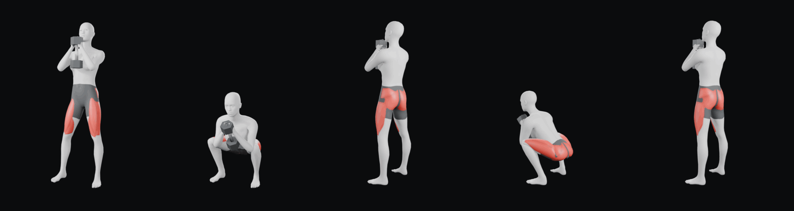

# Animaciones con mocap real — pipeline del proyecto

Pipeline acordado con el dueño (2026-10-24) para la biblioteca 3D: **el movimiento
sale de captura de movimiento real y el estilo de una sola plantilla de Blender**.
Así cada GIF tiene la misma figura, cámara, luz y fondo, y la biomecánica no se
inventa: v1 y v2 del pendulum fallaron porque las rodillas y codos se calculaban a mano.

Primer ejercicio: **Goblet Squat** → [`ejercicios/goblet-squat/goblet-squat.gif`](ejercicios/goblet-squat/goblet-squat.gif)

El GIF tiene dos repeticiones: la primera en 3/4 frontal (rodillas, pies y mancuerna)
y la segunda en 3/4 trasera (glúteos). La app reproduce un solo GIF por ejercicio,
así que la vista trasera va dentro del mismo archivo en vez de en otro.

Estado: **pendiente de aprobación visual del dueño**. No se ha subido a la app.

Correcciones del dueño (2026-10-24): la mancuerna iba sujeta demasiado baja (cabeza
superior en el esternón, la inferior en el abdomen) y en la bajada acababa frente al
vientre; ahora la cabeza superior queda bajo la barbilla durante todo el movimiento.
Se añadió la vista trasera para que se vean los glúteos.

Correcciones del dueño (2026-10-25): al final de la subida la cadera «se abría» después de
estirar las rodillas y la musculatura se veía plana.
- Técnica (medido con `verificar_tecnica.py`): el sujeto de CMU terminaba con el tronco a 20°
  y la cadera sin extender (156°), estiraba las rodillas antes que la cadera, tenía los pies
  asimétricos (28° y 5°) y la rodilla derecha se abría 13 cm por fuera del pie abajo. Ahora
  la pelvis se endereza en proporción a la altura (tronco a 7° arriba, el de reposo), cadera
  y rodilla se extienden a la vez (rodilla 175°), los dos pies abren 17° y las rodillas
  avanzan sobre la línea del pie.
- Pies (segunda revisión): heredaban del mocap una inclinación de 26° y 20° y no apoyaban la
  planta. Ahora usan la orientación de reposo de la figura (planta plana) con la apertura
  pedida y el tobillo a la altura de reposo.
- Cuerpo atlético (macros de MakeHuman) y atlas de músculos: recto femoral, vasto lateral,
  vasto medial, glúteo mayor y medio. Tercera revisión: solo rojo, sin fibras ni surcos
  marcados, para que se vea realista (`fibra_osc` y `fibra_relieve` a 0).

Referencias de técnica (coinciden en lo esencial): pies al ancho de cadera u hombros con las
puntas algo abiertas, peso al pecho, torso erguido, rodillas en la dirección de los pies,
bajar al menos hasta muslos paralelos y subir extendiendo cadera y rodillas por completo.
[NASM](https://www.nasm.org/resource-center/exercise-library/goblet-squat),
[Healthline](https://healthline.com/health/fitness-exercise/dumbbell-goblet-squat),
[MasterClass](https://www.masterclass.com/articles/goblet-squat-guide),
[O2 Fitness](https://blog.o2fitnessclubs.com/goblet-squats).

## Estándar visual (igual para todos los ejercicios)

| | Valor |
|---|---|
| Figura | Maniquí MPFB de `../3d/pendulum-squat.blend` (objeto `Human` + `Human.rig`) con cuerpo atlético: macros MakeHuman músculo 1.0 y peso 0.3 (paso 0); género, edad y proporciones sin cambiar |
| Colores | Piel gris claro (material `Maniqui`, color base lineal 0.60/0.60/0.61), short gris oscuro, músculos trabajados en rojo liso (`Musculo`) con forma anatómica del atlas `musculos.py`, volumen suave (bump) y separación tenue entre músculos (rojo 0.55/0.035/0.03); sin fibras |
| Fondo | `#0b0c0d` (composición sobre render con alfa) |
| Cámara | Una repetición por vista, misma distancia (3,09 m), altura 1,05 m y lente 50 mm, mirando a `(0, 0.08, 0.8)`. 3/4 frontal en `(1.25, -2.75, 1.05)`; 3/4 trasera a 125° en `(2.531, 1.852, 1.05)` cuando los músculos trabajados están detrás |
| Luces | Las tres del blend base (`Clave`, `Contra`, `Relleno`) |
| Render | EEVEE, 128 muestras (con menos aparece grano en el pecho) |
| GIF | 360×480, 24 fotogramas por vista, 12 fps (≈2 s por vista), 96 colores sin tramado, ≈ 250 KB por vista (la app acepta hasta 5 MB), primer fotograma de pie, corte de vista en la posición de pie |

## Pipeline (`herramientas/`)

0. `0_cuerpo_atletico.py` — sustituye las claves de forma de músculo y peso medios por sus
   variantes MakeHuman (`fuentes/makehuman/`, CC0) y mueve cada hueso con los cubos de
   articulación MPFB más cercanos (≤ 5 mm).
1. `1_retarget_mocap.py` — importa el BVH, orienta al sujeto hacia −Y y transfiere
   pelvis, columna, cuello, piernas y pies al rig MPFB (delta de rotación del
   mocap + alineación de reposo por hueso). Escala la traslación por longitud de
   pierna. `G_F0/G_F1` = tramo del BVH, `G_NF` = fotogramas, `G_BLEND` = cierre del bucle.
2. `2_pies_fijos.py` — pies clavados al suelo con solución **analítica** de dos
   huesos (el IK de Blender giraba la rodilla izquierda 30° en flexión profunda).
   El plano de la rodilla sale del mocap. Cerca de arriba extiende la rodilla a
   168° y centra la pelvis (el sujeto de CMU se queda con rodillas blandas).
   Opciones de técnica: `tronco_arriba` (inclinación del tronco arriba; la pelvis gira hacia
   atrás sobre el eje de las caderas en proporción a la altura), `apertura_pies` (misma
   apertura en los dos pies), `pies_planos` (planta apoyada con la orientación de reposo),
   `rodilla_pie` (1 = rodilla sobre la línea del pie) y
   `rodilla_arriba`.
3. `3_brazos_mancuerna_pecho.py` — mancuerna hexagonal en contacto con el pecho
   (raycast) y brazos IK con polo calibrado numéricamente. Específico del goblet;
   cada patrón de agarre tendrá su script.
4. `4_estilo.py` — máscara suavizada del short y, con `anatomia`, los músculos del atlas
   `musculos.py` horneados en una textura UV de 2048 px (empaquetada en el blend). Cada
   músculo es una región anatómica en reposo (muslo en coordenadas cilíndricas cadera→rodilla;
   glúteos como polígonos en la cara posterior) con ancho de vientre y dirección de fibra.
   Para otro ejercicio se añaden sus músculos al atlas y se nombran en `anatomia`.
5. `5_render.py` y 6. `6_codificar_gif.py` — render con alfa (una repetición por
   cámara de la lista JSON), composición y GIF.

Revisión: `verificar_tecnica.py` (tronco, cadera, rodilla, desviación de la rodilla frente
a la línea del pie y apertura de pies por fotograma), `revisar.py` (renders de cualquier cámara/fotograma), `hoja.py` (hoja de
contacto), `buscar_repeticiones.py` y `curva_repeticion.py` (encontrar una
repetición limpia en un BVH: rodilla, altura de cadera, talón, valgo).

Regenerar: `bash regenerar-goblet-squat.sh` (instrucciones de entorno dentro).
En la nube: `pip install bpy==5.2.2 pillow` en Python 3.13 y Mesa EGL
(`apt-get install libegl1 libegl-mesa0 libgl1-mesa-dri libgbm1`); el instalador
oficial de Blender está bloqueado por la red del contenedor. EEVEE por software
tarda ≈ 30 s por fotograma a 128 muestras.

## Verificaciones del Goblet Squat (medidas, no sustituyen la revisión visual)

- Deriva de los tobillos: **0 mm** en los 24 fotogramas.
- Pies: inclinación respecto a la planta de reposo **0°** en los 24 fotogramas; planta en el suelo.
- Técnica (`verificar_tecnica.py`): arriba tronco a 7° (el de reposo), cadera 164–169° (reposo
  167°) y rodilla 175°; cadera y rodilla se extienden en los mismos fotogramas (21: 145°/149°,
  22: 162°/170°). Abajo tronco a 47° y rodilla 40°/42° (sentadilla profunda, talones apoyados).
- Rodillas sobre la línea del pie en toda la flexión: desviación máxima **0,1 cm**. Pies abiertos 17°/17°.
- Mancuerna entre 0,5 y 5,8 mm del torso en los 24 fotogramas.
- `verificar_piernas.py` lista los fotogramas de pie (1, 22–24) en `valgo_frames`: con las piernas
  rectas y los pies más abiertos que la cadera, las rodillas quedan algo más juntas que los
  tobillos por geometría; no es valgo.
- GIF: 48 fotogramas, 476 KB (96 colores sin tramado).

## Fuente del cuerpo

`fuentes/makehuman/*.target.gz` — targets de macros de MakeHuman
(`makehumancommunity/makehuman`, commit `a8bc2d5`, `makehuman/data/targets/`), liberados
como CC0 en 2020. Solo los 16 necesarios (universal y pecho, joven, músculo y peso medios
o extremos), comprimidos.

## Fuente del movimiento

`fuentes/13_30.bvh` — CMU Graphics Lab Motion Capture Database, conversión BVH de
cgspeed (copia en `una-dinosauria/cmu-mocap`). Licencia: «free for use in research
and commercial projects worldwide». Crédito: *The data used in this project was
obtained from mocap.cs.cmu.edu. The database was created with funding from NSF
EIA-0196217.* Tramo usado: frames 1456–1700 (repetición 1 de las sentadillas).

## Añadir un ejercicio

1. Buscar el movimiento en el índice de CMU (`cmu-mocap-index-text.txt`) u otra
   fuente con licencia comercial; localizar una repetición limpia con
   `buscar_repeticiones.py` / `curva_repeticion.py` (talones planos, sin valgo,
   inicio y fin de pie).
2. Pasos 1–2 con el nuevo tramo; paso 3 según el equipo (agarre y objeto); paso 4
   con los músculos primarios del ejercicio.
3. Revisión visual frente, lado y espalda en arriba/abajo antes del GIF.
4. Aprobación del dueño antes de subir nada a la app.

## Límites conocidos

- CMU no cubre la mayoría de ejercicios de gimnasio. Para el resto: otras bases
  libres o mocap desde vídeo con licencia; las máquinas específicas (pendulum,
  belt squat, convergentes) hay que modelarlas.
- El atlas de músculos solo tiene cuádriceps y glúteos; cada ejercicio nuevo añade los suyos.
- El cuerpo atlético se aplica a toda la biblioteca (decisión del dueño, 2026-10-25).
