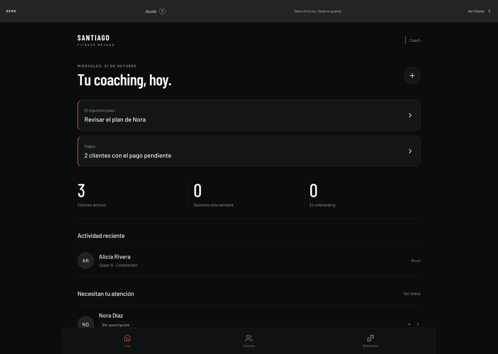
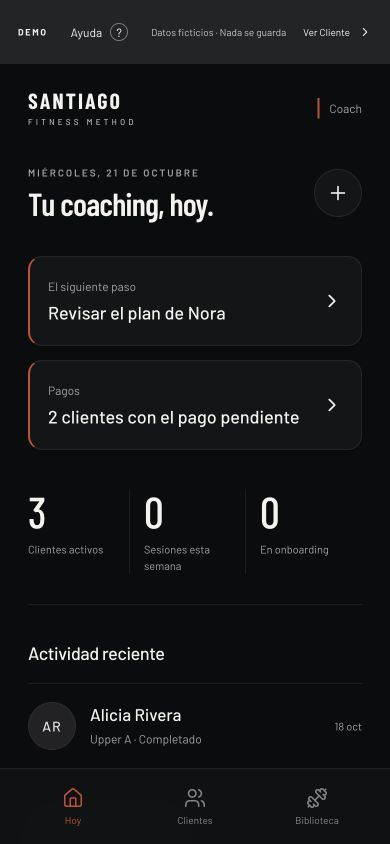
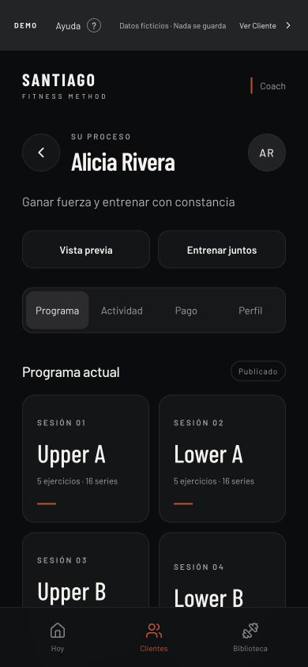
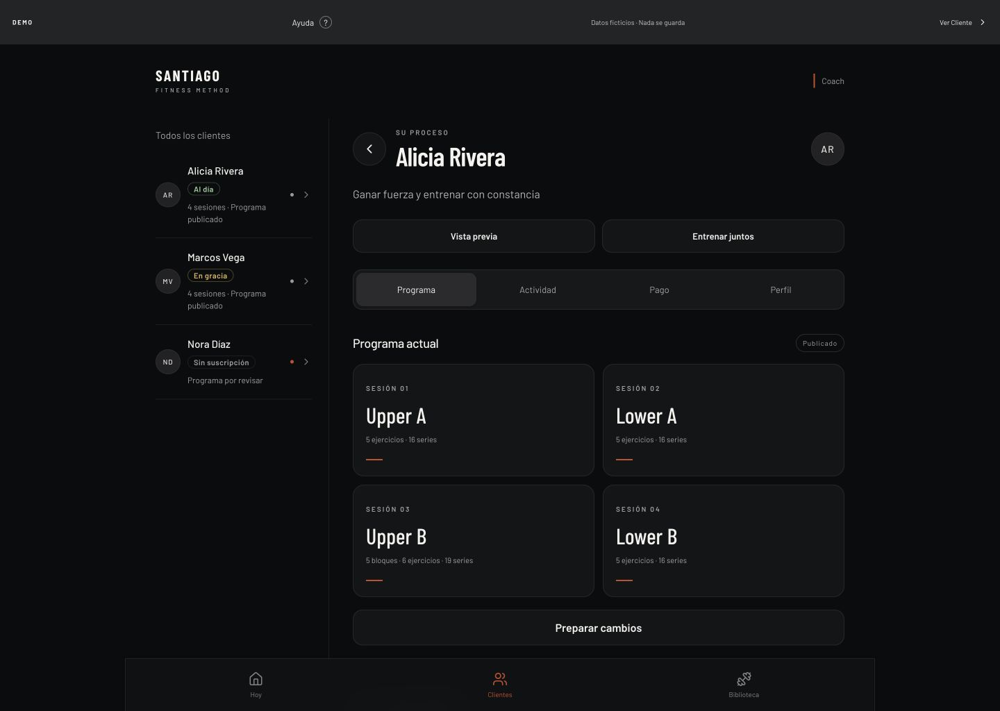
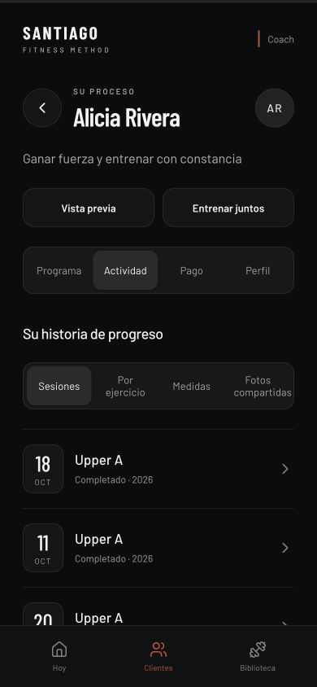
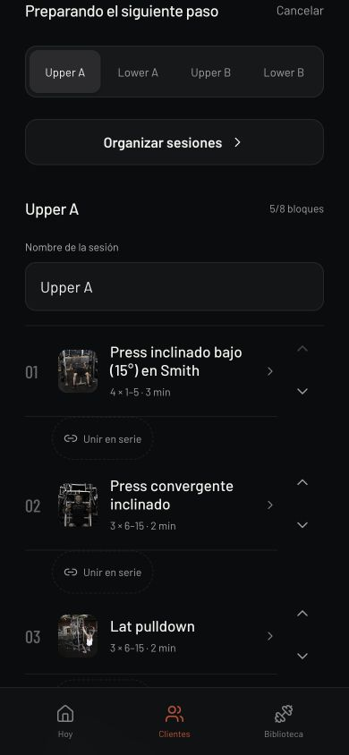
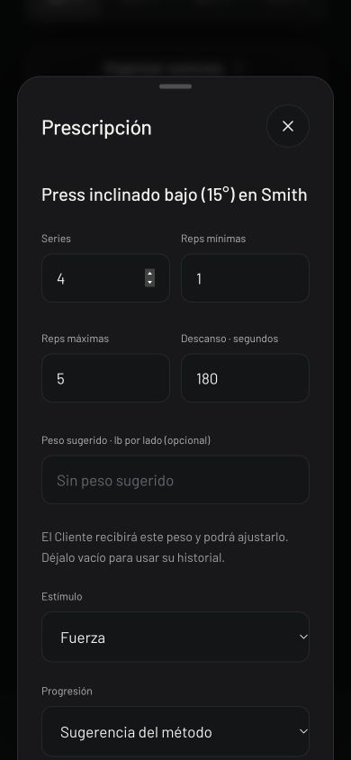
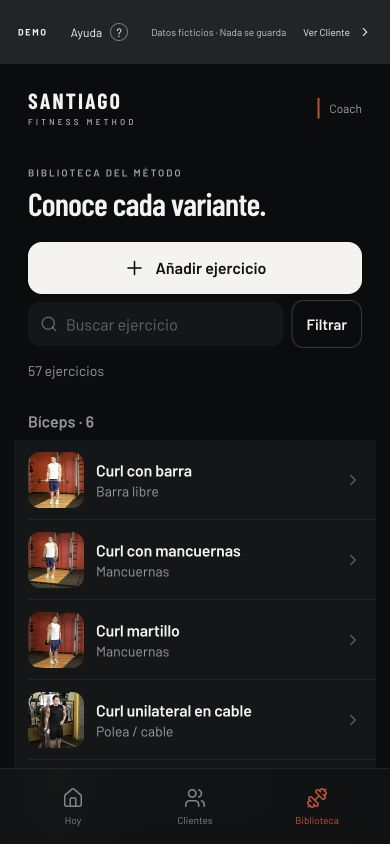
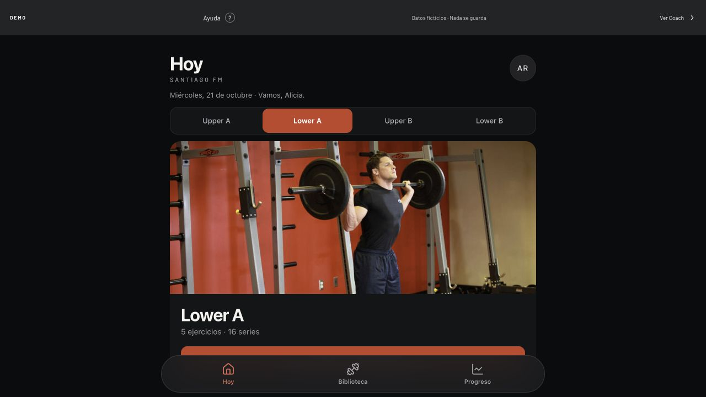

# Revisión de experiencia del coach

Fecha: 2026-10-21, Puerto Rico. Base de producto: merge `de9a703` del PR #11;
turno `a383808`. Superficie: demo compilada local, `/demo/coach`, en IAB.
Datos ficticios, sin cuentas reales. Capturas nuevas de este recorrido.

Objetivo: que Santiago encuentre a la persona que necesita revisión, consulte
su trabajo y prepare la rutina con una jerarquía coherente con el cliente aprobado.
Se revisa el uso móvil y de escritorio, sin implementar cambios.

## Recorrido y hallazgos

### 1. Hoy — operativo, prioridades demasiado separadas

La siguiente acción ya existe: revisar el programa de Nora. También se separan
pagos, contadores y actividad. Es buena base funcional; la composición le concede
mucho espacio a cabecera y contadores antes de mostrar la lista de atención.
En móvil 390×844, «Necesitan tu atención» empieza en **y=810**, bajo las pestañas.
No significa que sea inaccesible: requiere bajar. Nora también aparece arriba
como siguiente paso, así que no se presenta como una acción ausente.

En escritorio, la columna central conserva la misma secuencia vertical y deja
amplios márgenes. Conviene acercar prioridades y clientes, sin añadir métricas.
No se detectó desborde horizontal en Hoy móvil.

### 2. Clientes y búsqueda — operativos, cabecera más larga que la tarea

Buscar «Alicia» reduce la lista a una persona. Los estados de programa y pago
tienen texto, además de color; no hay que deducirlos del punto. El titular
«Personas, antes que planes.» ocupa dos líneas y desplaza búsqueda/lista.
Priorizar «Clientes», la búsqueda y filas agrupadas facilitaría el acceso.
Crear cliente existe en dos puntos; puede conservarse una acción visible y
mantener la otra contextual según tamaño. No se creó ningún cliente.

### 3. Ficha y programa — operativos, rutina debajo de varios niveles

Objetivo, Vista previa, Entrenar juntos y las cuatro secciones tienen valor.
En móvil, la primera sesión empieza cerca de y=500: demasiada altura para
llegar a la rutina. Las tarjetas de días muestran poca información en mucha
superficie. Una cabecera compacta y sesiones como filas podrían acercar la
programación sin eliminar datos. En escritorio **ya existe** lista lateral de
clientes; se debe conservar y mejorar, no venderla como función nueva.
Sin desborde horizontal en la ficha a 1440×1024.

### 4. Actividad — operativa, demasiadas capas de navegación

Se consultan las tres sesiones históricas de Alicia. «Actividad» contiene otra
selección de Sesiones, Por ejercicio, Medidas y Fotos compartidas. Estas son
funciones existentes; el rediseño debe ordenar su jerarquía y no inventar gráficos
o alertas. La captura refleja el scroll que dejó la activación de esa sección.
La actividad más reciente es **18 oct** y no pertenece a la semana actual
(19–25 oct); el contador de **0 sesiones esta semana** es coherente.

### 5. Preparar cambios — operativo, edición con información repetida

El editor ofrece días, nombre, miniaturas, prescripciones, orden y bi-series.
Se abrió el borrador en memoria y se canceló sin guardar ni publicar. El contexto
del cliente y las secciones anteriores añaden scroll antes del editor; conviene
darle una cabecera propia breve y explicar claramente qué es borrador y qué está
publicado. Conservar rangos, lb por lado, bloques/bi-series, límites y validación.
La captura está desplazada hasta el editor, no al inicio del documento.

### 6. Prescripción — operativa, formulario largo

La hoja ya tiene asa, cierre, campos etiquetados y explica el peso sugerido.
«Listo» queda después de varios campos y requiere scroll en 390×844.
Agrupar series/reps/descanso y mantener una acción clara puede reducir esfuerzo
sin quitar Estímulo, Progresión o la posibilidad de dejar el peso vacío.
Cerrar devuelve el foco al ejercicio: observado en el DOM. No se cambiaron valores.

### 7. Biblioteca — operativa, creación por delante de la búsqueda

La búsqueda y los grupos musculares existen. En el primer viewport la acción
grande «Añadir ejercicio» precede a la búsqueda. Para uso frecuente de seleccionar
y consultar, conviene dar prioridad a buscar y reducir la acción de crear.
La demo muestra **57 ejercicios**: no describe el tamaño del catálogo de Santiago.
Se conservan fotos, GIF, procedencia y ejercicios del coach; esta revisión no
modifica el catálogo ni prueba subida de archivos.

## Riesgos de accesibilidad y límites

- Vistos: texto secundario pequeño/tenue, nombres largos en filas y controles
  de orden con poco protagonismo. Revisar tamaño, contraste y área táctil al
  implementar. Son riesgos visuales; no se certifica un fallo WCAG solo por JPEG.
- Fortalezas observadas: campos con nombre accesible, estados con texto,
  secciones con `aria-pressed`, navegación nombrada y retorno de foco al cerrar
  Prescripción. No equivale a una auditoría completa de teclado o lector de pantalla.
- Sin errores de consola en las vistas consultadas. No se provocaron errores de
  red, validación o guardado en una cuenta real.
- No se probaron en esta fase: Safari nativo, PWA instalada, VoiceOver, gestos,
  rendimiento de hardware, onboarding, pagos de verdad, invitación o publicación.
  Esos recorridos requieren QA de la implementación futura; no se atribuye una
  prueba nueva al QA del cliente.
- Se rechazó una primera captura móvil de Hoy tomada durante el ajuste de
  viewport. `02-hoy-movil.jpg` es la repetición estable a 390×844.
- El JPEG de IAB altera la apariencia del rojo respecto al CSS. Los conceptos
  usan los tokens CSS y la referencia PNG del cliente aprobado, no ese tinte.

## Dirección recomendada para las propuestas

Mantener SFM oscuro/rojo, firma Barlow y tipografía de sistema para controles.
Usar agrupación y jerarquía antes que más tarjetas. Mostrar una acción principal,
clientes y contexto útil; los pagos permanecen visibles como apoyo.
Explorar tres entradas: prioridad de revisión, directorio de personas y actividad.
Las tres usan los mismos datos; cambiar la jerarquía no autoriza nuevas funciones.

Móvil: cabecera compacta, lista legible, controles ≥44 px y pestañas coherentes
con el cliente. Escritorio: conservar el patrón existente de lista/ficha, reducir
espacio vertical y aprovechar columnas cuando la lectura lo justifique. La
adaptación detallada depende de la propuesta elegida, no está implementada.

Referencia de familia visual capturada en este recorrido:

